# 十分钟制作横版动作游戏｜Godot 4 教程《勇者传说》#0

> 原作者：瓦格良  
> 原文：[Bilibili 专栏 cv23952012](https://www.bilibili.com/read/cv23952012)  
> 所属文集：[勇者传说｜Godot 笔记](https://www.bilibili.com/read/readlist/rl782393)  
> 本地编号：1/9

---

## 《勇者传说 #0》教程笔记

## 设置窗口：

像素风设置：

1、项目设置 =》打开高级设置 =》 显示 =》 窗口

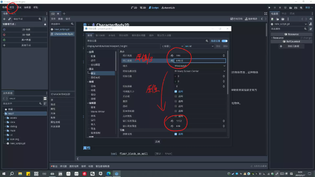

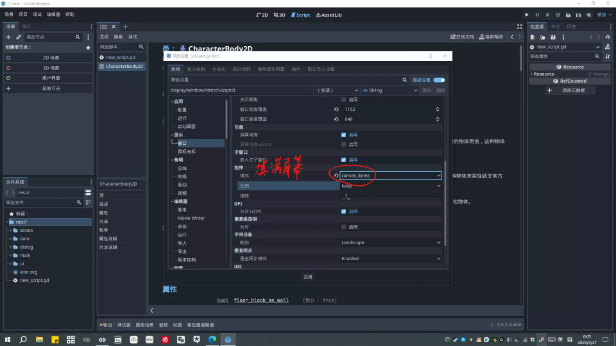

## 场景：

- 新建2D场景并重命名为World

- 添加一个子节点TileMap

- 在TileMap右侧检查器中Tile Set属性中选择新建TileSet

- 点击TileSet，展开Physics Layer，点击添加元素

- 切换到底部的TileSet面板

- 把事先准备好的素材图片拖入图块，弹窗选择否(是否在不透明纹理区创建)

- 在基础图块中选择自己想要使用的图块

- 切换到绘制选项，选择物理层0，对图块涂抹，即可设置好碰撞区域

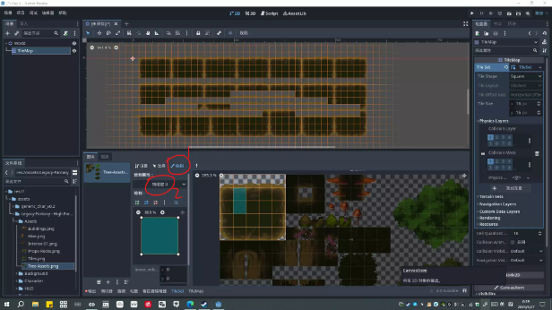

9.切换到下方的TileMap面板，选择图块进行绘制
  - 左键绘制

  - 右键删除

  - 安装shift是画直线

  - 按住crtl+shift是画矩形

10.保存当前场景

11.选择其他节点新建场景

12.新建节点CharacterBody2D，改名为Player，添加子节点Sprite2D(用来显示图像)

13.将事先准备好的玩家动画图片拖入Sprite2D，图片放大后默认比较模糊

14.在项目=》项目设置=》渲染=》纹理=》默认纹理过滤 改为 Nearest

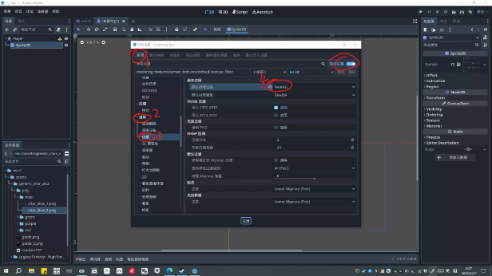

15.在右侧Region中勾选Enable，点击编辑区域，吸附模式修改为栅格吸附，步长设置为56*56像素，圈起第一行的6帧动画

16.在右侧Animation中，修改Hframes(水平帧数)为6

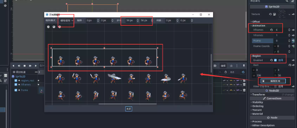

17.调整角色最下中点到原点

18.在根节点下添加CollisionShape2D节点，定义碰撞形状，在右侧Shape属性中新建RectangleSharp2D，并调整大概位置覆盖角色主体

19.添加AnimationPlayer节点，用来定义动画，新建动画命名为idle

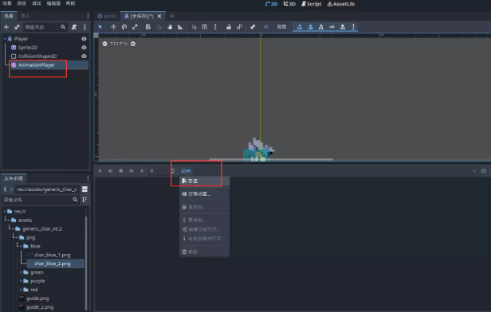

20.设置总长度为0.6秒，打开循环

21.切换到Sprite2D节点，点击右侧Region的Rect属性右侧的钥匙符号添加关键帧，点击Hframes添加关键帧，Frame添加关键帧，因为有6帧动画，所以要添加6个Frame关键帧

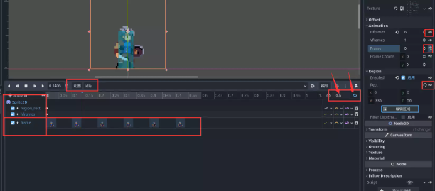

22.按照上面的做法再添加running动画

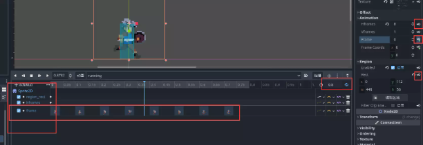

23.再制作jump动画

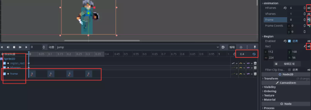

24.保存当前场景

25.在Player场景的根节点添加脚本控制角色的行为

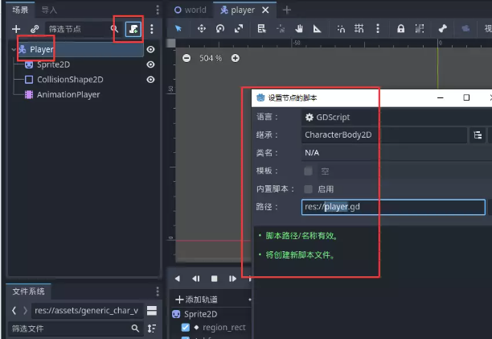

26.编写脚本

```gdscript
extends CharacterBody2D

# 获取引擎给的重力加速度
var gravty := ProjectSettings.get("physics/2d/default_gravity") as float

func _physics_process(delta: float) -> void:
	velocity.y += gravty * delta
	move_and_slide()

```

27.在World场景的根节点实例化角色

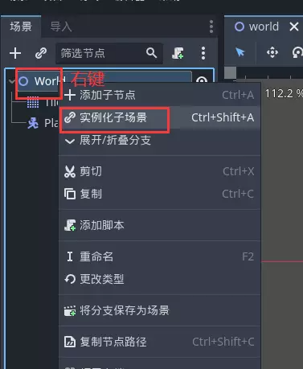

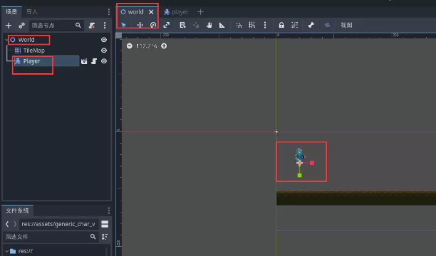

28. 在项目=》项目设置=》输入映射添加3个按键
  - move_left(A)

  - move_right(D)

  - jump(空格)

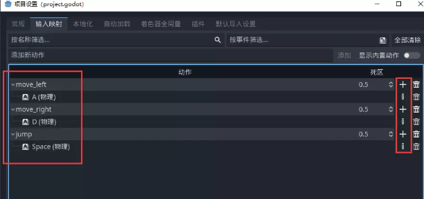

29. 完整脚本

```gdscript
extends CharacterBody2D
@onready var animation_player: AnimationPlayer = $AnimationPlayer
@onready var sprite_2d: Sprite2D = $Sprite2D

const RUN_SPEED := 200.0
# 是负数的原因是因为在2D空间中y轴向上为负
const JUMP_VELOCITY := -300.0
# 获取引擎给的重力加速度
var gravty := ProjectSettings.get("physics/2d/default_gravity") as float

# 每个物理帧调用一次
func _physics_process(delta: float) -> void:
	# 获取按键输入
	var direction :=  Input.get_axis("move_left","move_right")
	# 修改速度向量
	velocity.x = direction * RUN_SPEED
	velocity.y += gravty * delta

	# 如果在地板上并且按下了jump键，那么就修改角色y坐标变为跳跃值
	if is_on_floor() and Input.is_action_just_pressed("jump"):
		velocity.y = JUMP_VELOCITY

	# 如果在地板上，没有移动则播放idle动画，有移动则播放running动画，如果不在地板上则播放jump动画
	if is_on_floor():
		if is_zero_approx(direction):
			animation_player.play("idle")
		else:
			animation_player.play("running")
	else:
		animation_player.play("jump")

	# 如果在移动，并且是向左移动，那么将角色水平翻转
	if not is_zero_approx(direction):
		sprite_2d.flip_h = direction < 0
	move_and_slide()

```
