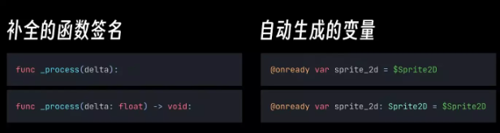
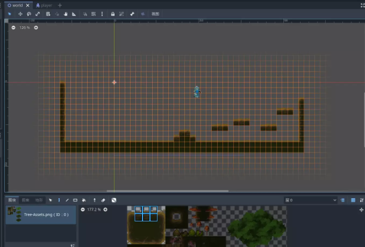
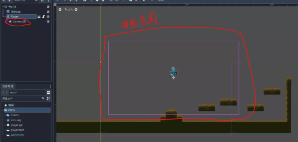
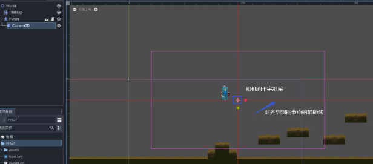
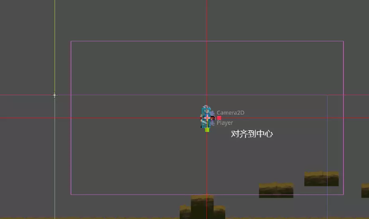
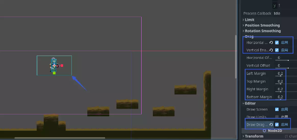
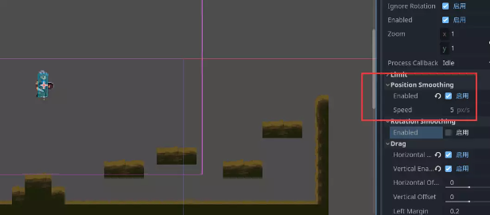
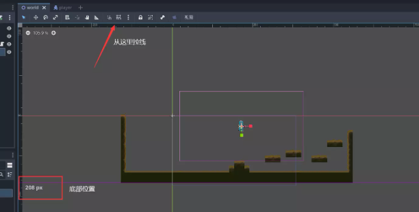
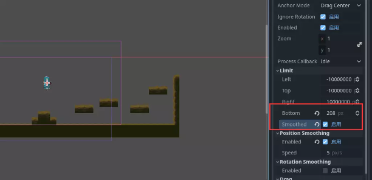

# 通过相机发现更大的世界｜Godot 4 教程《勇者传说》#1

> 原作者：瓦格良  
> 原文：[Bilibili 专栏 cv23972760](https://www.bilibili.com/read/cv23972760)  
> 所属文集：[勇者传说｜Godot 笔记](https://www.bilibili.com/read/readlist/rl782393)  
> 本地编号：2/9

---

## 勇者传说 #1

## 设置编辑器：

- 点击编辑器=》编辑器设置=》文本编辑器=》不全=》添加类型提示(勾选)

  - 类型补全能够提gdscripts性能

  - 后续补全能利用到类型信息



## 场景

1.选择world场景，选择TileMap节点，点击下方TileMap菜单，选择图块进行地图扩展
  - crtl+左键点击 吸取单个图块

  - crtl+按住左键拖动 吸取多个图块

  - crtl+shift+按住左键拖动 绘制矩形区域

  - 右键删除图块



2.让画面跟随玩家移动，给Player节点添加Camera2D节点



3.拖动相机的十字准星，可以调整相机的位置，按住crtl再拖动，可以方便的对齐到其他节点



4.对齐到Player节点的中心



5.游戏中相机并不总是跟随玩家，玩家在屏幕中心附近有一定的自由活动空间
  - 在Camera2D节点的Drag属性勾选Horizontal Enable和Vertical Enable （水平和垂直方向上的相机拖动功能）

  - 在Camera2D节点的Editor属性勾选Draw Drag Margin，可以观察到可自由活动的范围，通过调整Drag属性的Left Margin等，可以控制其大小，值是0至1的比例



6.实现相机平滑移动，勾选Camera2D节点的Position Smoothing下的Enabled
  - 其中Speed可调整相机的平滑移动速度



7.限制相机拍摄范围，禁止相机拍到地图外，利用标尺量出地图底部距离，然后在Camera2D的Limit中设置Bottom为量出的数值，接着勾选Smoothed实现相机碰到极限时平滑移动





8.代码自动限制相机范围，给World根节点添加脚本

```gdscript
extends Node2D
@onready var tile_map: TileMap = $TileMap
@onready var camera_2d: Camera2D = $Player/Camera2D

func _ready() -> void:
	# 获取瓦片地图的范围
	var used := tile_map.get_used_rect()
	# 获取单个图块的尺寸
	var tile_size:=tile_map.tile_set.tile_size
	# 为相机的上下左右添加限制
	camera_2d.limit_top= used.position.y * tile_size.y
	camera_2d.limit_right= used.end.x * tile_size.x
	camera_2d.limit_bottom= used.end.y * tile_size.y
	camera_2d.limit_left= used.position.x * tile_size.x
	# 将相机的位置立即设置为其当前平滑的目标位置。
	camera_2d.reset_smoothing()

```
