# 如何使用 TileMap｜Godot 4 教程《勇者传说》#2

> 原作者：瓦格良  
> 原文：[Bilibili 专栏 cv23978148](https://www.bilibili.com/read/cv23978148)  
> 所属文集：[勇者传说｜Godot 笔记](https://www.bilibili.com/read/readlist/rl782393)  
> 本地编号：3/9

---

## Godot 4.7 校订

Godot 4.7 已弃用 `TileMap`，官方建议按用途拆成多个 `TileMapLayer`。原教程中 `TileMap.Layers` 的操作应映射为场景树中的独立节点：

```text
MapVisuals
├── Background (TileMapLayer)
├── Geometry   (TileMapLayer)
└── Foreground (TileMapLayer)
```

- 三个节点可以共享同一个 `TileSet`，但各自拥有独立的可见性、`z_index`、Y Sort、碰撞和导航设置。
- 地形集仍在 `TileSet` 中配置；地形绘制仍依赖完整的边/角组合。某个组合缺失时，自动地形无法稳定选择正确图块。
- `Match Corners`、概率、替代图块和散布绘制仍可用。概率适合视觉变体，不应承载必需碰撞或玩法逻辑。
- `TileMapLayer` 更新会在帧末批处理。只有代码必须在同一帧立即读取新碰撞或场景图块时，才调用 `update_internals()`。
- Godot 4.7 的 2D Scene Paint Mode（默认快捷键 `B`）适合散布装饰、敌人和收集物；连续地面及其碰撞仍应由 `TileMapLayer` 负责。
- 教程的前提是图集包含目标拓扑所需的角、边和中心组合，再由 Terrain 自动选图。本项目重新审计 `Forest-1.png` 全部 33×21 单元后确认：`(5,4)/(6,4)` 是贴地高台凹角的下半格，`(7,3)` 可提供上半格草冠。项目将它们按左右岩壁轮廓裁成两个 1×2 派生凹角，避免单格缺草或整格草冠深入土墙。当前仍缺洞穴下侧凹角和 45° 泥土斜坡。
- 草冠与下方泥土属于同一个扩展顶面图块：TileSet 中合并为 `1×2` atlas 区域并设置 `texture_origin.y = 8`，只绘制到 `GeometryTiles`。不得把草冠单独画进 `BackgroundTiles`，否则会出现重复草带、层级重叠和接缝。
- 运行时先把布局转换为占用单元，再通过 Terrain Set 按“扩展顶面 / 左右侧墙 / 内部填充 / 底部封口 / 左右凹角”自动选图。`merge_with_ground` 高台可与主地面合并；洞穴顶板和 45° 斜坡仍不在当前规则范围。实体 Terrain 图块携带碰撞，装饰层不携带碰撞。

运行时连接地形的基本写法：

```gdscript
@onready var ground: TileMapLayer = $Geometry

func paint_ground(cells: Array[Vector2i]) -> void:
	const TERRAIN_SET := 0
	const GROUND_TERRAIN := 0
	ground.set_cells_terrain_connect(cells, TERRAIN_SET, GROUND_TERRAIN)
```

本项目的森林图块资源是 [forest_tileset.tres](../../../data/forest_tileset.tres)，关卡绘制脚本是 [level_2_forest_tile_painter.gd](../../../scripts/tools/level_2_forest_tile_painter.gd)。官方参考：[使用 TileMap](https://docs.godotengine.org/en/4.7/tutorials/2d/using_tilemaps.html)、[TileMapLayer](https://docs.godotengine.org/en/4.7/classes/class_tilemaplayer.html)。

两段补充视频的整理与本项目执行规范见：[动态瓦片与场景叠层工作流](../tilemap-rule-and-layering-workflow.md)。

## 原教程正文（历史界面）

## 场景：

1.选中TileMap节点，切换到底部的TileSet面板

a. 在不想添加的图块上右键选择删除

b. 有些图块是有扩展出去的部分(地面、蘑菇)，比单独图块更好的方法是扩展图块本身

c. 选中【选择】工具，选中有扩展部分的图块，点中小红点向扩展的方向拖动（如果扩展图块在最上面，那么就只能从上向下拖）

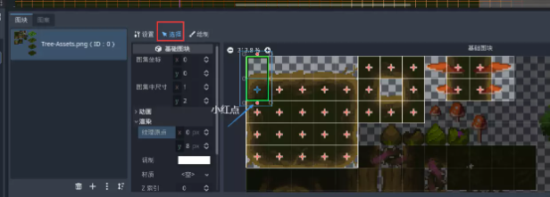

d. 橙色框表示的是单元格相对于图块的位置，在【选中】=》【渲染】=》【纹理原点】，设置y为8

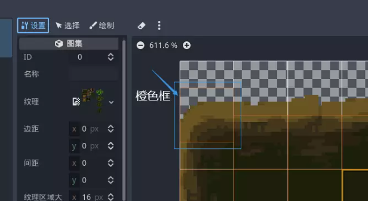

e. 在【绘制】工具中选中纹理原点，调整y值，即可批量操作

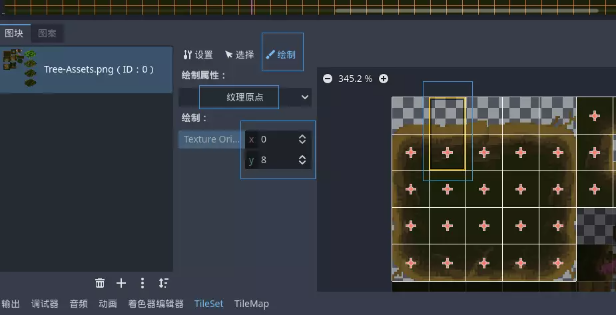

f. 在【绘制】工具中选中物理层0，按住crtl+shift拖动，即可为所有选中的图块设置物理碰撞层

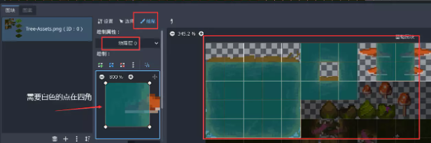

2. 使用地形可自动绘制需要的图块

a. 选中TileMap节点，选择Tile Set属性，展开Terrain Sets，点击添加元素，即可添加一个地形集，选择地形集的图块模式为Match Corners，根据图块角落匹配，在Terrains添加元素就是添加实际地形，取一个有意义的名字(Trunk)

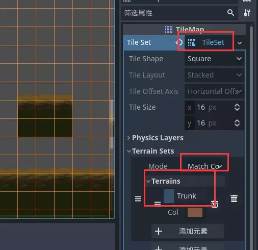

b. 选中下方TileSet，选中【绘制】，切换绘制属性为【地形】，Terrain Set选择Terrain Set0,按住crtl+shift拖动即可将所有图块纳入到这个地形集，在Terrain选择Trunk，为图块设置邻接图块匹配规则

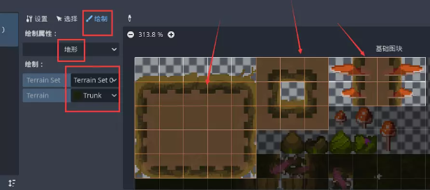

c. 选中下方TileMap，选中【地形】，选中Trunk地形，即可在编辑器进行绘制

d. 按住crtl+shift直接画大方块，然后再修改细节能获得更高效率

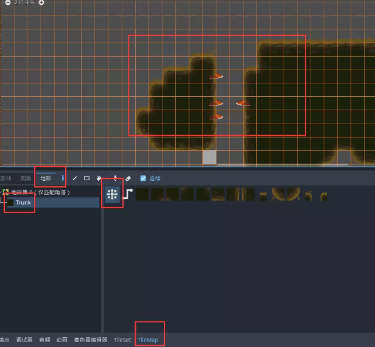

e. 选中下方TileSet，在【绘制属性】中选中概率，调整Probability数值，然后涂抹想要降低出现概率的图块

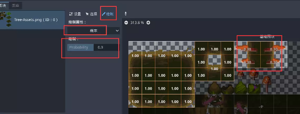

f. 装饰图块,利用散布可以使多个选中的图块按照一定概率随机出现

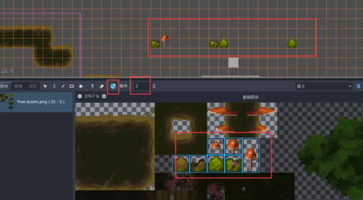

g. 选中下方TileSet，在【绘制属性】中选中概率，调整Probability数值，然后涂抹想要降低出现概率的图块

h. 在TileMap节点的Layers属性中，将默认给的图层命名为Geometry,点击下方添加元素，再添加一个图层，命名为ForeGround

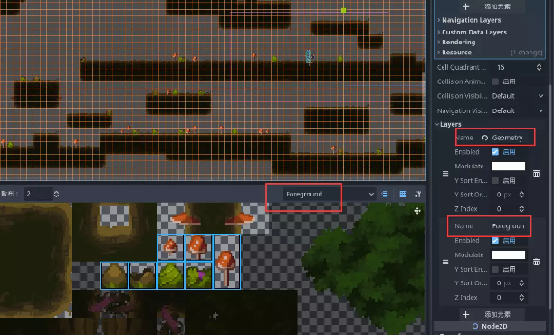

i. 隐藏地图边界

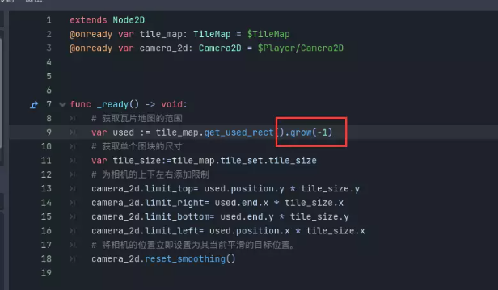

j. 再添加一个图层，命名为Background，并将图层拖动到最上方，在Terrain Sets的Terrains中添加一个地形，起名为Leaves

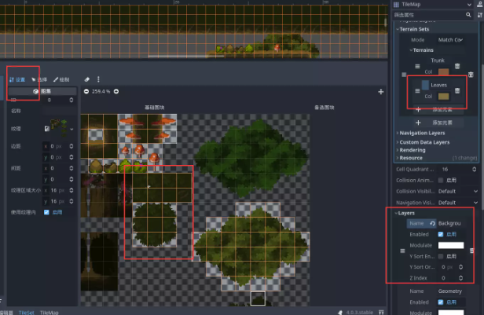

k. 将较少用的图块设置概率为0.3

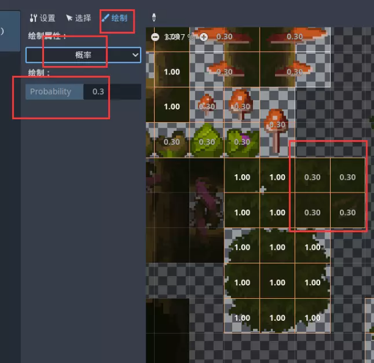

l. 设置地形邻接匹配规则

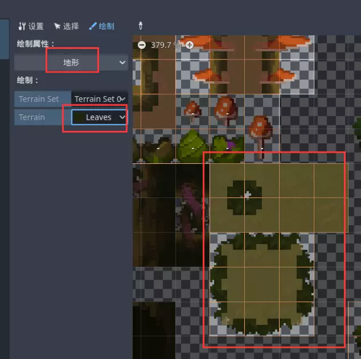

m. 选择TileMap的地形，如果没有出现Leaves，那么先关掉TileMap再打开即可，选择Background图层，开始绘制

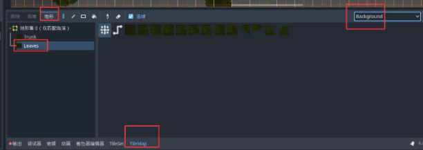

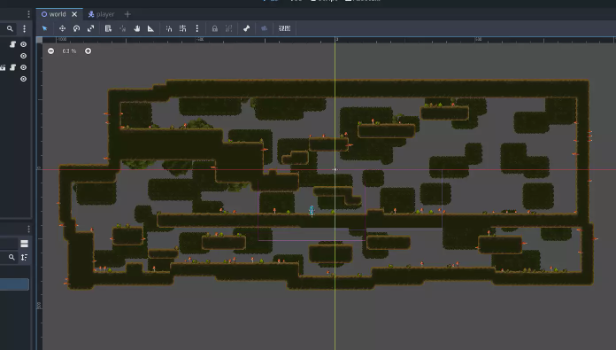
