# 如何实现视差背景｜Godot 4 教程《勇者传说》#3

> 原作者：瓦格良  
> 原文：[Bilibili 专栏 cv24333389](https://www.bilibili.com/read/cv24333389)  
> 所属文集：[勇者传说｜Godot 笔记](https://www.bilibili.com/read/readlist/rl782393)  
> 本地编号：4/9

---

## Godot 4.7 校订

Godot 4.7 已弃用 `ParallaxBackground` 和 `ParallaxLayer`，官方推荐使用 `Parallax2D`。原教程的每个独立滚动层都应变成一个 `Parallax2D`：

| 旧节点/属性 | Godot 4.7 |
| --- | --- |
| `ParallaxBackground` + `ParallaxLayer` | 每个滚动层一个 `Parallax2D` |
| `ParallaxLayer.motion_scale` | `Parallax2D.scroll_scale` |
| `ParallaxLayer.motion_mirroring` | `Parallax2D.repeat_size` |
| `ParallaxBackground.layer` | 使用 `CanvasLayer` 或 `CanvasItem.z_index` 组织前后景 |

推荐场景树：

```text
Decorations (Node2D)
├── Sky       (Parallax2D, scroll_scale = 0.1)
│   └── Sprite2D
├── Hills     (Parallax2D, scroll_scale = 0.3)
│   └── Sprite2D
├── Trees     (Parallax2D, scroll_scale = 0.6)
│   └── Sprite2D
└── Foreground (Parallax2D, scroll_scale = 1.1, z_index > 0)
    └── Sprite2D
```

- `scroll_scale = Vector2.ONE` 表示与相机同速；小于 `1` 看起来更远，大于 `1` 看起来更近。
- 无缝循环使用 `repeat_size`。子纹理应从局部坐标 `(0, 0)` 开始覆盖重复区域，重复宽度至少覆盖视口；缩放不会自动计入 `repeat_size`。
- 不要把接缝一概归因于引擎 Bug。常见原因包括 Region 边界采样、纹理过滤、透明边缘、重复尺寸错误，以及相机平滑与像素吸附组合。
- 像素风优先使用 `Nearest`、整数缩放和已裁好的独立纹理。必须使用 Region 时，确保纹理重复模式和边缘留白正确。
- 本项目森林关卡使用 `DistantForest / MidForest / NearForest` 三个 `Parallax2D`，重复周期统一为逻辑视口宽度 640 像素。每一层只放置一个周期内的素材实例，由 `repeat_size` 负责扩展，禁止按整关长度复制树节点。
- 三层树木都必须位于实体地形的有效 `z_index` 之后。注意子 `CanvasItem` 默认启用相对 Z，父子负值会相加；测试应比较有效 Z，而不能只看场景文件中的单个数字。树木可以延伸到地面基线，但基线以下必须由不透明地形遮蔽。

官方参考：[2D 视差教程](https://docs.godotengine.org/en/4.7/tutorials/2d/2d_parallax.html)、[Parallax2D](https://docs.godotengine.org/en/4.7/classes/class_parallax2d.html)。

## 原教程正文（历史界面）

## 知识点：

视差背景：越远处的物体相对移动速度越小

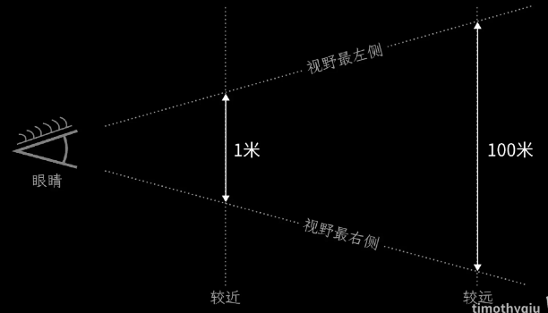

举例：手机左右平移录像，前排的小松鼠从屏幕一边移动到另一边，但是后排离我们很远的米妮只移动了很小的距离

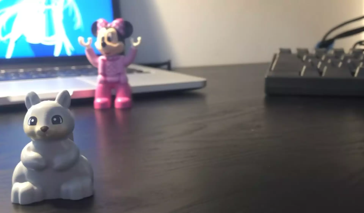

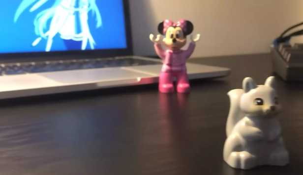

场景：
- ParallaxBackground节点：专门用来创建视差滚动背景的节点，是个单纯的管理节点，能够感知到相机在场景的移动，然后按照一定的比例移动它下面的ParallaxLayer节点

- ParallaxLayer节点：实际上按照一定比例移动的图层

1.在World节点下创建ParallaxBackground节点，并在ParallaxBackground节点下创建ParallaxLayer节点，并改名Sky

2.选中Sky节点后，按住ctrl键拖动res://assets/Legacy-Fantasy - High Forest 2.3/Background/Background.png 素材到场景中

 a. 放下时按住Ctrl以添加为所选节点的子节点。

 b. 放下时按住Shift以添加为所选节点的同级节点。

 c. 放下时按住Alt以添加为不同的节点类型。

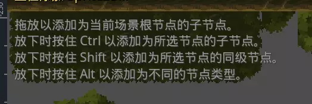

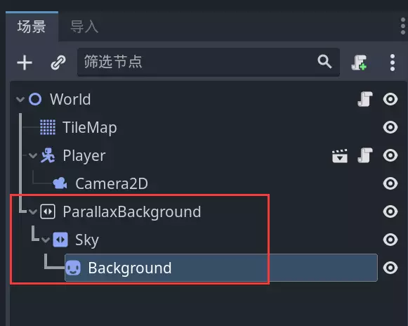

3.选中Background节点，将检查器中Offset中的Centered属性取消勾选，重置Transform属性中的Position

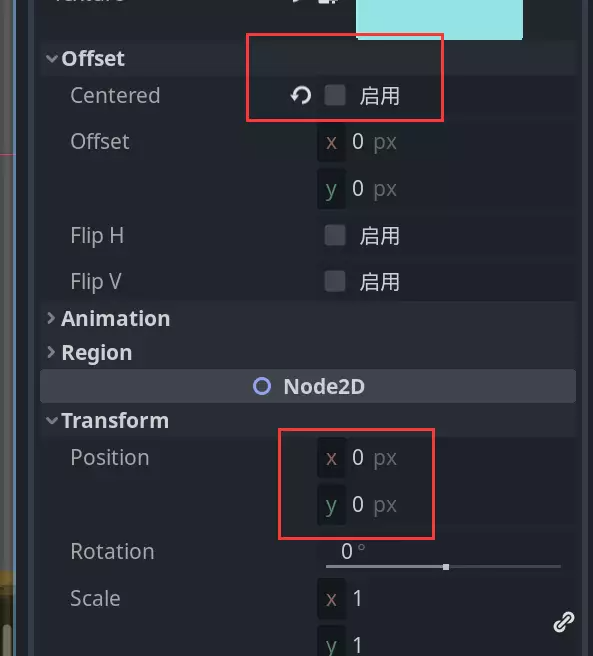

4.选中Sky节点，调整Motion属性的Scale选项，点击链接按钮(🔗)取消链接状态，将x调整为0.3，y调整为0.1，运行测试可以发现已经产生了视差效果；

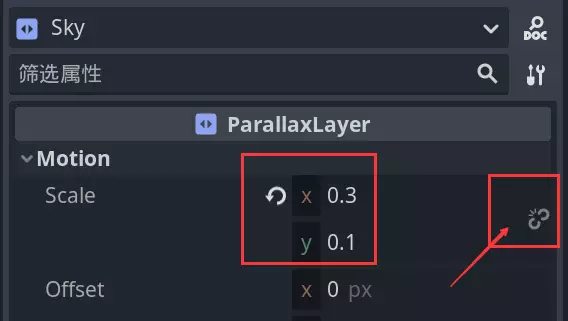

5.调整Background节点的高度，一边运行一边手动拖动图片，直到看不到最上方的灰色区域，并且保证下方也有余量看不到灰色区域

 a. 单显示器临时调整：项目 ==》 项目设置 ==》常规 ==》 显示 ==》 窗口 ==》 置顶

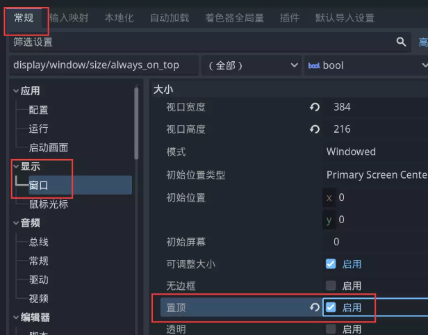

6.选中Sky节点，调整Motion属性的Mirroring选项，x设置为480，左右两边就不会再看到灰色区域

 a. 实际是在480px后又重新绘制原本的内容

 b. 不是简单的相机移动多少，就按照比例移动多少

 c. 会在0到-480px之间来回移动即可实现无限滚动

 d.需要原本的图片至少和屏幕一样宽

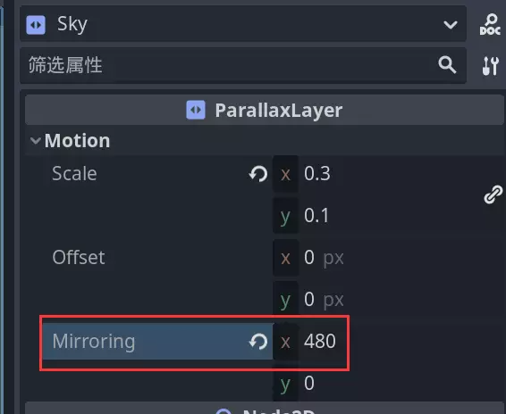

7.添加山脉

 a. 在ParallaxBackground节点下创建ParallaxLayer节点，改名为Hills

 b. 拖动res://assets/Legacy-Fantasy - High Forest 2.3/Trees/Background.png到Hills节点下

 c. 选中Hills节点下的Background节点

 d. 勾选Region属性的Enabled选项，点击属性下方编辑区域

 e. 吸附模式选择栅格吸附，调整上方步长为8*8px

 f. 框中最右侧的山脉

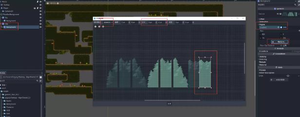

 g. 关闭Offset属性的Centered选项

 h. 调整山脉对齐Y坐标轴

 i. 复制4份山脉图片，并依次紧密排列

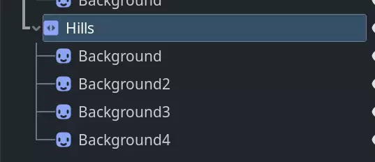

 j. 调整Hills节点的Motion属性的Morroring选项，x为384

 k. 调整Hills节点的Motion属性的Scale选项，x为0.5，y为0.2

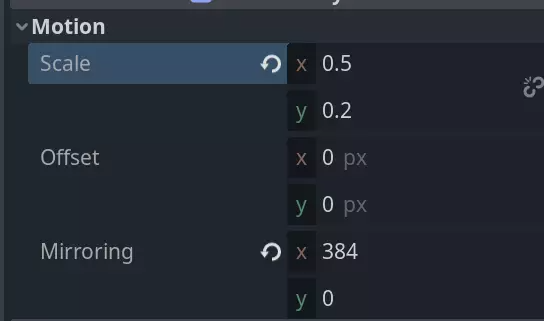

8.添加树木，方法同添加山脉

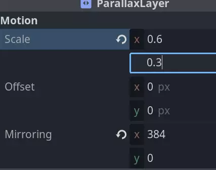

9.偶尔出现下面这种线

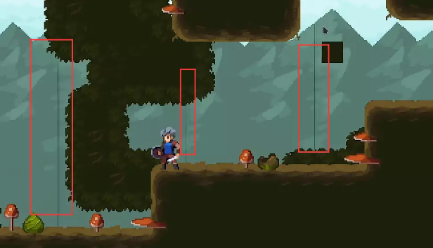

 a. 这是godot自己的bug

 b. Sprite2D的纹理区域和Camera2D的Position Smoothing有冲突

 c. 解决方法：

 i. 项目 ==》 项目设置 ==》 常规 ==》 渲染 ==》 2D ==》 吸附==》 任意启用其中一个吸附选项(缺点是场景所有东西都会对齐到像素，相机慢下来会出现明显的画面抖动)

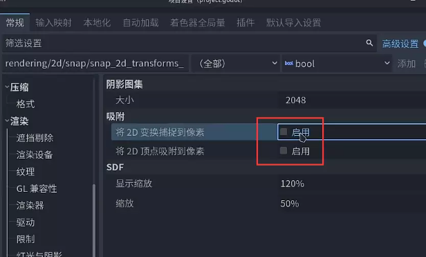

 ii. 将用到的山脉和树木裁剪成为单独的图片，避免使用纹理区域即可，将Texture替换为单独图片后，记得将Region的Enabled选项取消

10.添加草丛

 a. 在ParallaxBackground节点下创建ParallaxLayer节点，改名为Bushs

 b. 调整Bushs节点的Motion属性的Scale选项：x为0.9，y为0.9

 c. 将res://assets/Legacy-Fantasy - High Forest 2.3/Assets/Tree-Assets.png 拖入Bushs节点，勾选Region属性的Ebabled选项，点击编辑区域，吸附模式选择自动裁剪，选中较亮的绿色图块，因为这个图块不需要平铺，所以不用单独裁剪来防止出现上面的竖线问题

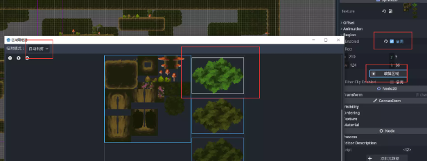

 d.利用上面复制山和树的方式，多复制出一些草丛，调整到自己想要的位置

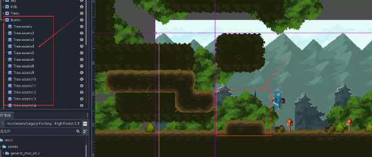

11.将ParallaxBackground节点更名为Background

12.创建一个新的ParallaxBackground节点，命名为Foreground

13.修改Foreground节点的Layer属性为正值 1 ，因为普通节点都在第0层

14.在Foreground节点下添加ParallaxLayer节点，命名为Bushs，设置Motion属性，x为1.1，y为1.1
  - 将res://assets/Legacy-Fantasy - High Forest 2.3/Assets/Tree-Assets.png 拖入Bushs节点，勾选Region属性的Ebabled选项，点击编辑区域，吸附模式选择自动裁剪，选中较暗的绿色图块

  - 添加前景草丛方法和上面添加草丛方法相同，按照自己喜欢的位置摆放

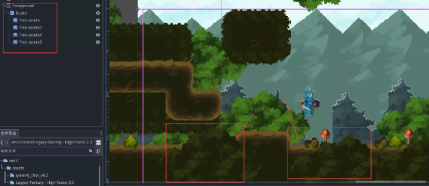

15.防止误触调整视差背景
  - 按住shift同时选中Background和Foreground节点

  - 右键选择重设父节点为新节点

  - 将两个节点放置到新的Node2D节点下，重命名为Decorations

  - 将Decorations节点加锁和编组

  - 平时就无法选中视差背景

  - 需要调整视差背景的时候，取消编组即可

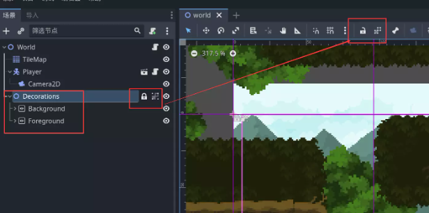
