# 如何实现丝滑的运动｜Godot 4 教程《勇者传说》#4

> 原作者：瓦格良  
> 原文：[Bilibili 专栏 cv27731770](https://www.bilibili.com/read/cv27731770)  
> 所属文集：[勇者传说｜Godot 笔记](https://www.bilibili.com/read/readlist/rl782393)  
> 本地编号：5/9

---

## 勇者传说 #4

## 知识点：

-  郊狼时间：出自华纳公司的卡通形象威利狼，特点是在跑出悬崖后并不会立即坠落，而是依然能悬空一小段时间。

## 场景：

- 为了让角色丝滑的运动，修改角色脚本(player.gd)的移动速度RUN_SPEED=160和跳跃高度JUMP_VELOCITY=-320

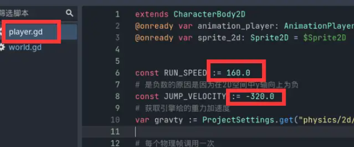

- 修改速度向量用move_toward()函数，按住ctrl+鼠标左键点击函数，可以跳转到编辑器内置的文档

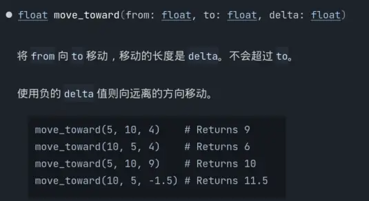

- 为了让角色能在起步和停止有个过程，添加水平加速度

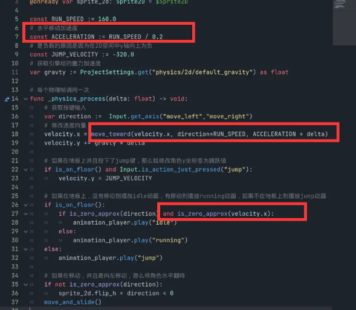

- 为了让角色空中转体更丝滑，将水平加速度修改为地面加速度，并添加空中转体加速度

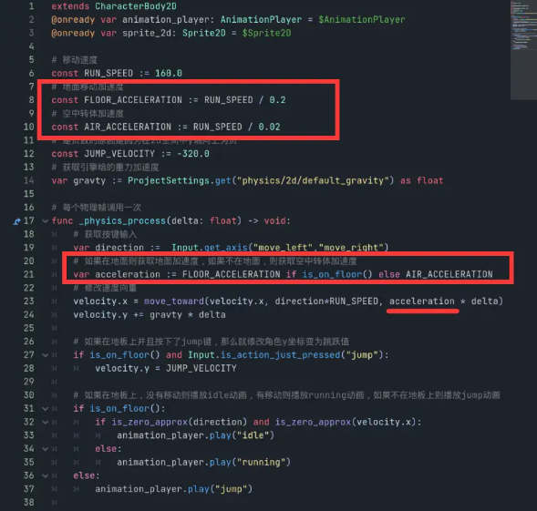

-  为角色添加郊狼时间，让角色能离开平台后的一段时间依然能起跳

a. 添加一个计时器改名为CoyoteTimer

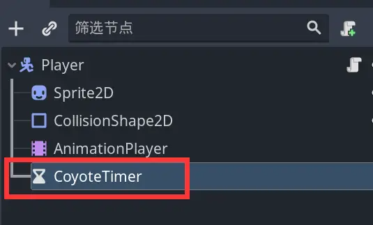

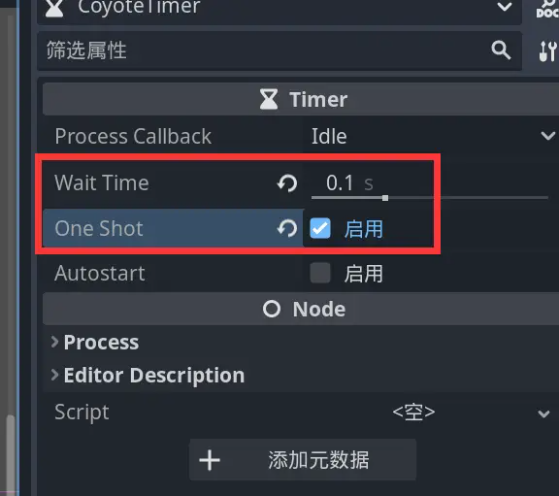

b. 判断角色是否在地面上

c. 如果移动之前在地面，移动后，角色离开了地面

d. 启动郊狼时间的计时器

e. 否则就是角色着陆了，可以提前停止计时器

f. 角色离开地面有两种情况，一种是走出平台，一种是主动起跳，需要避免主动起跳触发郊狼时间的情况，单独设置角色当前是否起跳的状态

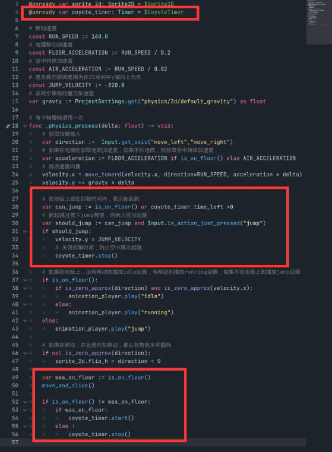

- 为角色添加跳跃预输入

  - 添加计时器改名为JumpRequestTimer

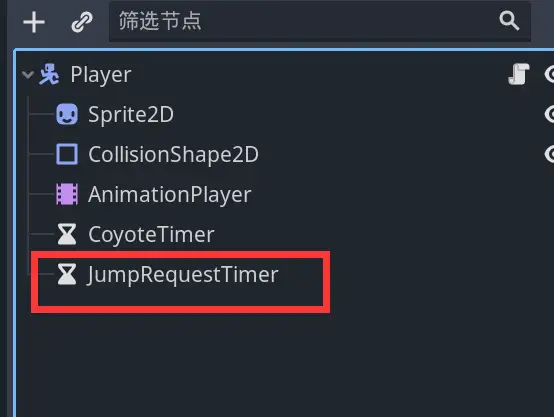

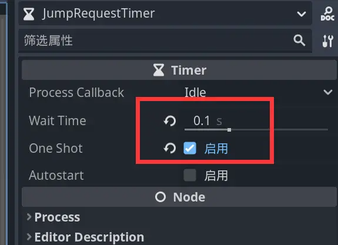

- 按下jump键的时刻启动计时器

- 不每帧判断是否按下jump按键，而是使用事件回调函数_unhandled_input()判断

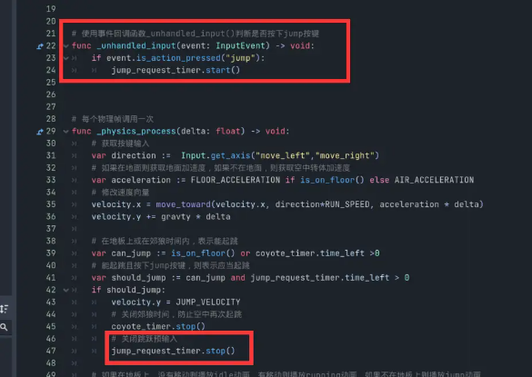

- 为角色添加不同强度的跳跃

  - 短按轻跳，长按大跳

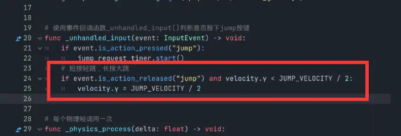
