# 如何实现状态机｜Godot 4 教程《勇者传说》#5

> 原作者：瓦格良  
> 原文：[Bilibili 专栏 cv29657471](https://www.bilibili.com/read/cv29657471)  
> 所属文集：[勇者传说｜Godot 笔记](https://www.bilibili.com/read/readlist/rl782393)  
> 本地编号：6/9

---

## 勇者传说 #5

## fix：


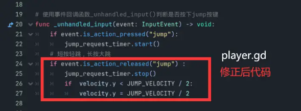

##

## 知识点：

-  有限状态机（英语：finite-state machine，缩写：FSM）又称有限状态自动机（英语：finite-state automaton，缩写：FSA），简称状态机，是表示有限个状态以及在这些状态之间的转移和动作等行为的数学计算模型。


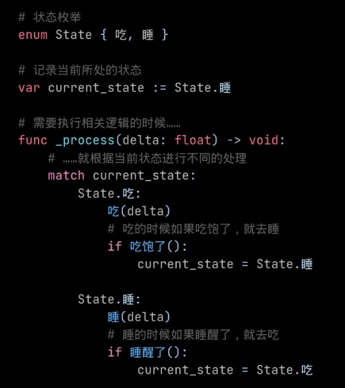

- 枚举

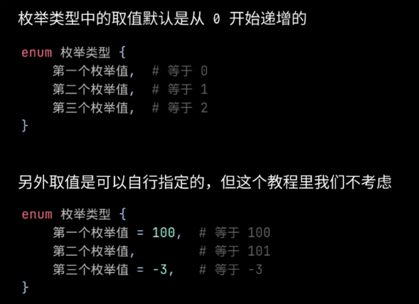

## 场景：

- 添加动画

  - 下落

    - 新建动画命名为 fall

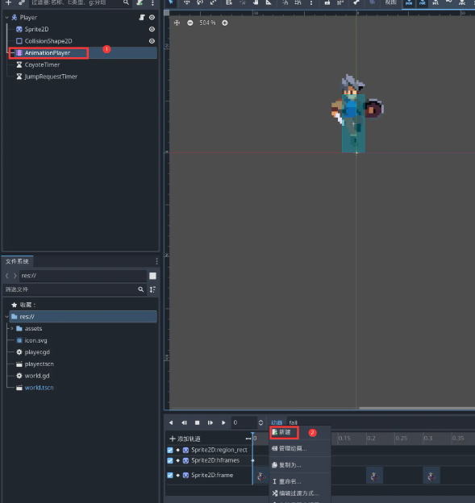

    - 选择精灵

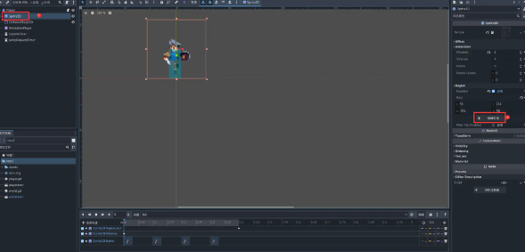

    - 调整精灵步长为56*56

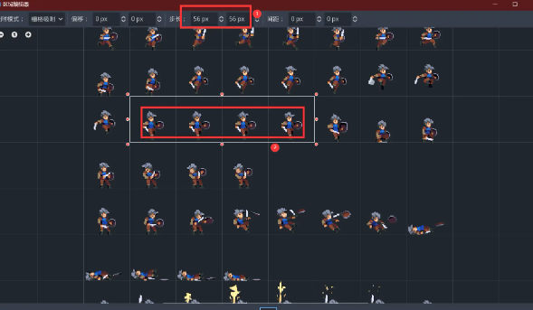

- 添加关键帧

  - 点击Rect后的钥匙按钮添加关键帧

  - 动画有4帧，调整Hframes为4，然后点击后方钥匙按钮添加关键帧

  - 将Frame先调整为0，然后点击其后方的钥匙添加关键帧，因为有4帧，所以需要添加4次

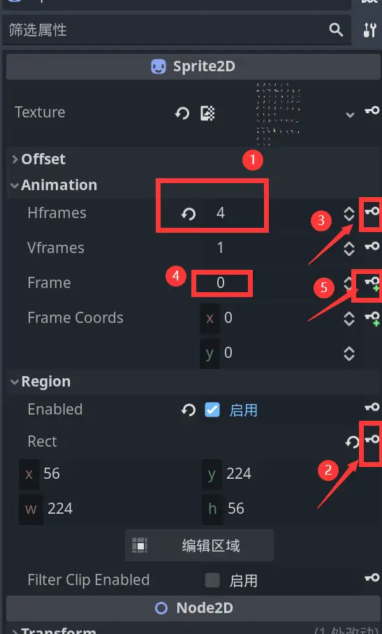

- 调整右下角每帧间隔为0.1秒，整体如下图

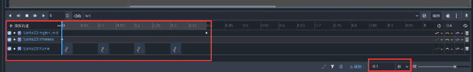

- 着陆（添加同上）

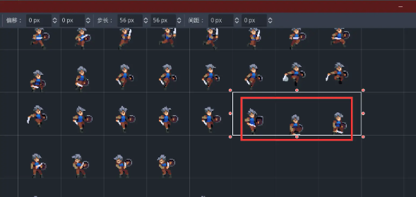

- 状态机脚本

  - 新建脚本命名为StateMachine.gd并保存在新建的classes文件夹内

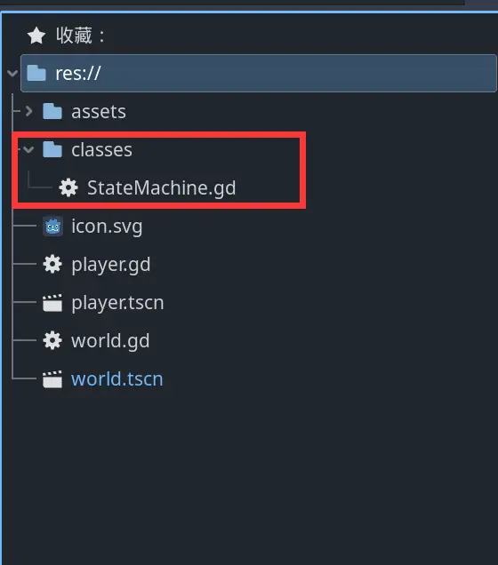

- 在脚本中添加类名为StateMachine

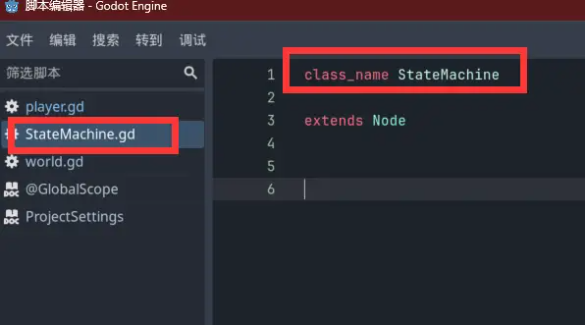

- 在Player场景中添加刚才创建好的StatMachine节点

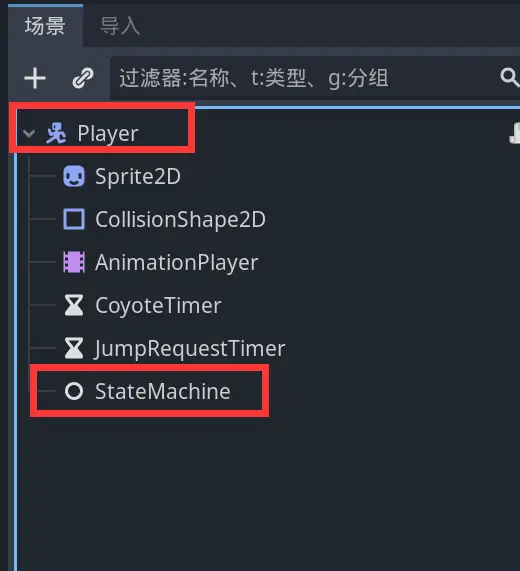

因涉及到较多编码与代码替换内容，此处直接放出最终代码
- player.gd

```gdscript
extends CharacterBody2D

# 状态机枚举
enum State {
	IDEL,
	RUNNING,
	JUMP,
	FALL,
	LANDING,
}

@onready var animation_player: AnimationPlayer = $AnimationPlayer
@onready var sprite_2d: Sprite2D = $Sprite2D
@onready var coyote_timer: Timer = $CoyoteTimer
@onready var jump_request_timer: Timer = $JumpRequestTimer

# 角色在地面的状态列表
const GROUND_STATES := [State.IDEL,State.RUNNING,State.LANDING]
# 移动速度
const RUN_SPEED := 160.0
# 地面移动加速度
const FLOOR_ACCELERATION := RUN_SPEED / 0.2
# 空中转体加速度
const AIR_ACCELERATION := RUN_SPEED / 0.02
# 是负数的原因是因为在2D空间中y轴向上为负
const JUMP_VELOCITY := -320.0
# 获取引擎给的重力加速度
var default_gravity := ProjectSettings.get("physics/2d/default_gravity") as float
# 当前是否第一帧
var is_first_tick := false

# 使用事件回调函数_unhandled_input()判断是否按下jump按键
func _unhandled_input(event: InputEvent) -> void:
	if event.is_action_pressed("jump"):
		jump_request_timer.start()
	# 短按轻跳，长按大跳
	if event.is_action_released("jump") :
		jump_request_timer.stop()
		if  velocity.y < JUMP_VELOCITY / 2:
			velocity.y = JUMP_VELOCITY / 2

# 执行对应状态
func tick_physics(state:State,delta: float) -> void:
	match state:
		State.IDEL:
			move(default_gravity,delta)
		State.RUNNING:
			move(default_gravity,delta)
		State.JUMP:
			move(0.0 if is_first_tick else default_gravity,delta)
		State.FALL:
			move(default_gravity,delta)
		State.LANDING:
			stand(delta)
	is_first_tick = false

# 移动
func move(gravity:float, delta: float) -> void:
	# 获取按键输入
	var direction :=  Input.get_axis("move_left","move_right")
	# 如果在地面则获取地面加速度，如果不在地面，则获取空中转体加速度
	var acceleration := FLOOR_ACCELERATION if is_on_floor() else AIR_ACCELERATION
	# 修改速度向量
	velocity.x = move_toward(velocity.x, direction*RUN_SPEED, acceleration * delta)
	velocity.y += gravity * delta

	# 如果在移动，并且是向左移动，那么将角色水平翻转
	if not is_zero_approx(direction):
		sprite_2d.flip_h = direction < 0

	move_and_slide()

# 站立
func stand(delta: float) -> void:
	# 如果在地面则获取地面加速度，如果不在地面，则获取空中转体加速度
	var acceleration := FLOOR_ACCELERATION if is_on_floor() else AIR_ACCELERATION
	# 修改速度向量
	velocity.x = move_toward(velocity.x, 0.0, acceleration * delta)
	velocity.y += default_gravity * delta

	move_and_slide()

# 获取下一个状态
func get_next_state(state:State) -> State:
	# 在地板上或在郊狼时间内，表示能起跳
	var can_jump := is_on_floor() or coyote_timer.time_left >0
	# 能起跳且按下jump按键，则表示应当起跳
	var should_jump := can_jump and jump_request_timer.time_left > 0
	if should_jump:
		return State.JUMP
	# 获取按键输入
	var direction :=  Input.get_axis("move_left","move_right")
	# 是否站立状态
	var is_still := is_zero_approx(direction) and is_zero_approx(velocity.x)
	match state:
		State.IDEL:
			if not is_on_floor():
				return State.FALL
			if not is_still:
				return State.RUNNING

		State.RUNNING:
			if is_still:
				return State.IDEL

		State.JUMP:
			if velocity.y >= 0:
				return State.FALL

		State.FALL:
			if is_on_floor():
				return State.LANDING if is_still else State.RUNNING

		State.LANDING:
			if not animation_player.is_playing():
				return State.IDEL

	return state

# 状态转换
func transition_state(from: State, to:State)->void:
	# 之前不处于在地面的状态要切换到地面状态
	if from not in GROUND_STATES and to in GROUND_STATES:
		coyote_timer.stop()

	match to:
		State.IDEL:
			animation_player.play("idle")

		State.RUNNING:
			animation_player.play("running")

		State.JUMP:
			animation_player.play("jump")
			velocity.y = JUMP_VELOCITY
			# 关闭郊狼时间，防止空中再次起跳
			coyote_timer.stop()
			# 关闭跳跃预输入
			jump_request_timer.stop()

		State.FALL:
			animation_player.play("fall")
			if from in GROUND_STATES:
				coyote_timer.start()

		State.LANDING:
			animation_player.play("landing")

	is_first_tick = true

```

- StateMachine.gd

```gdscript
class_name StateMachine

extends Node

var current_state: int = -1 :
	set(v):
		owner.transition_state(current_state,v)
		current_state = v

func _ready() -> void:
	# godot中子节点ready后父节点才ready，此处等待父节点ready后再执行后续代码
	await owner.ready
	current_state = 0

func _physics_process(delta: float) -> void:
	while true:
		var next := owner.get_next_state(current_state) as int
		if current_state == next:
			break
		current_state = next

	owner.tick_physics(current_state,delta)

```
