# 如何实现滑墙｜Godot 4 教程《勇者传说》#6

> 原作者：瓦格良  
> 原文：[Bilibili 专栏 cv29746105](https://www.bilibili.com/read/cv29746105)  
> 所属文集：[勇者传说｜Godot 笔记](https://www.bilibili.com/read/readlist/rl782393)  
> 本地编号：7/9

---

#### 勇者传说 #6

人物素材： https://brullov.itch.io/generic-char-asset

环境素材： https://anokolisa.itch.io/sidescroller-pixelart-sprites-asset-pack-forest-16x16

插件地址：https://codeload.github.com/timothyqiu/godot-animation-resetter/zip/refs/heads/master

## 场景：

- 制作滑墙动画

  - 新建动画命名为wall_sliding

  - 精灵图使用 res://assets/generic_char_v0.2/png/blue/char_blue_2.png

  - 选择精灵

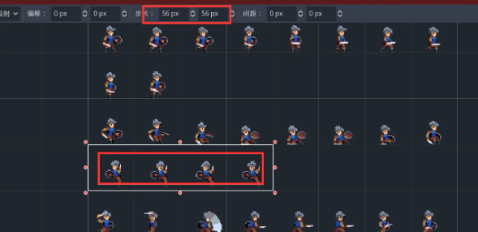

- 添加关键帧

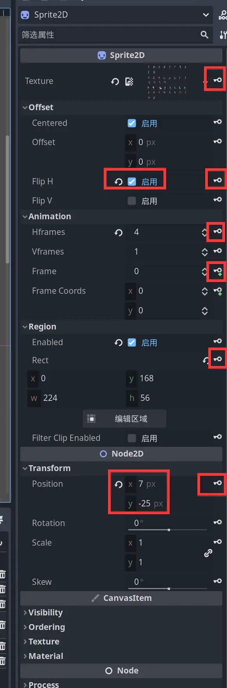

- 重做玩家翻转

  - 重设Sprite2D父节点为新建的Node2D节点

  - 将新建的Node2D节点改名为Graphics

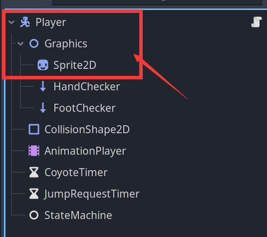

  - 调整动画(因为滑墙使用了和其他动画不一样的精灵图片)

    - 安装Animation Resetter插件

      - 从引擎直接安装

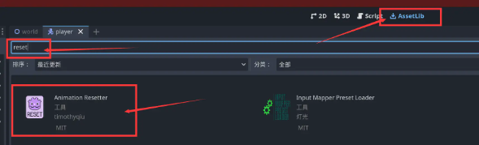

- 下载安装：https://codeload.github.com/timothyqiu/godot-animation-resetter/zip/refs/heads/master

  - 解压到项目根目录

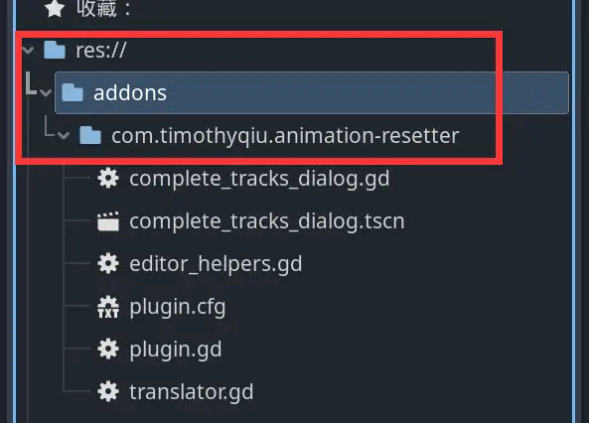

- 启用插件

  - 项目 =》 项目设置 =》 启用

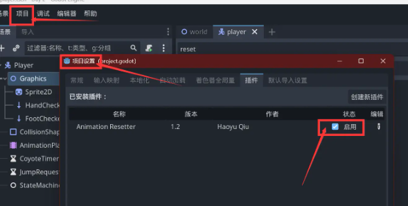

- 将除了滑墙之外的其他动画从RESET补全轨道，确认即可（当然不嫌麻烦也可以不使用插件，纯手工将所有动画的轨道手动调整为自己想要的设置）

  - tips：若遇到动画不合理的，需要自己再手动调整，如果是有关键帧的，需要调整关键帧设置

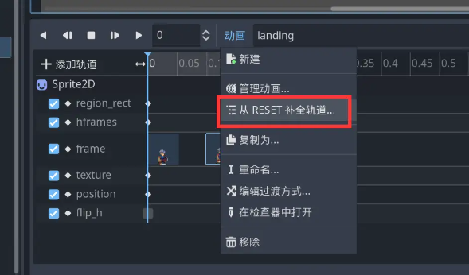

- 滑墙实现

  - 为Graphics节点添加两个RayCast2D节点，一个命名为HandChecker，另一个命名为FootChecker

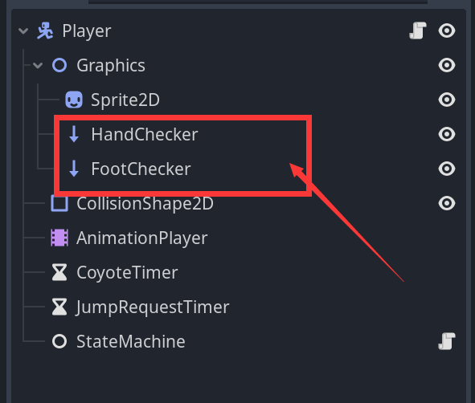

  - 绑定位置如图

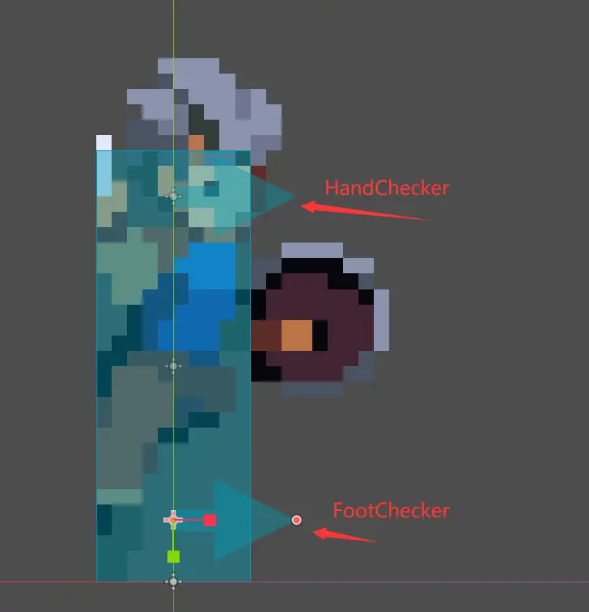

- 修改脚本

  - 添加滑墙状态

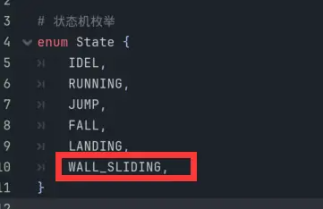

- 将Graphics节点和两个RayCast2D节点拖入脚本中

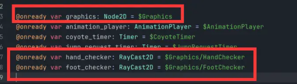

- 使用Graphics节点的Scale属性实现翻转

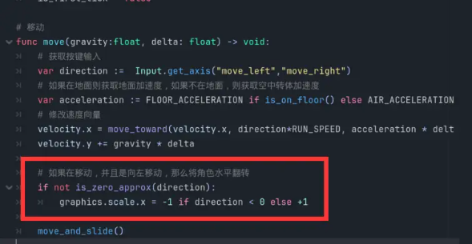

- 添加滑墙的状态实现

  - 重力调整为三分之一

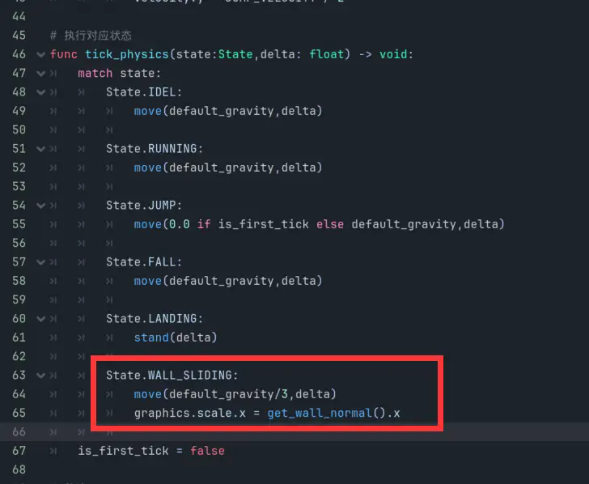

- 实现获取滑墙状态，优化下落状态

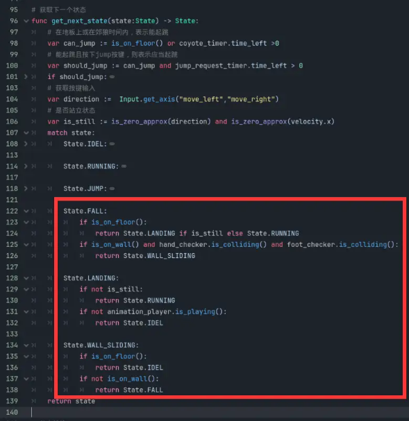

- 播放滑墙动画

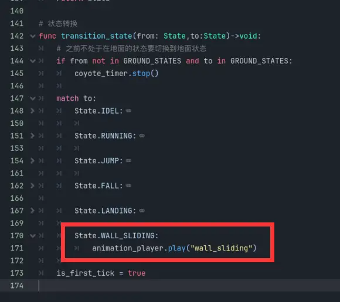

- 其他优化

  - 优化下落动画

    - 稍微调整fall动画初始位置，向下移动一些，避免走路下落的时候会突然升高

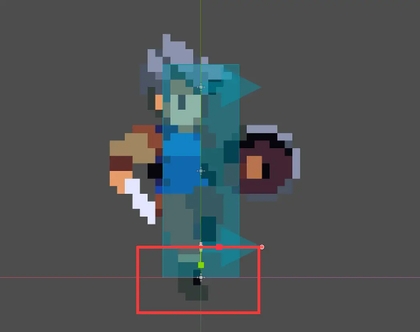

- 优化落地动画

  - 因为fall动画的最后一帧动画与landing动画第一帧一致

  - 删除landing动画第一帧，调整动画播放时长为0.2秒

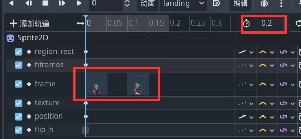

## 代码：

- player.gd

```gdscript
extends CharacterBody2D

# 状态机枚举
enum State {
	IDEL,
	RUNNING,
	JUMP,
	FALL,
	LANDING,
	WALL_SLIDING,
}

@onready var graphics: Node2D = $Graphics
@onready var animation_player: AnimationPlayer = $AnimationPlayer
@onready var coyote_timer: Timer = $CoyoteTimer
@onready var jump_request_timer: Timer = $JumpRequestTimer
@onready var hand_checker: RayCast2D = $Graphics/HandChecker
@onready var foot_checker: RayCast2D = $Graphics/FootChecker

# 角色在地面的状态列表
const GROUND_STATES := [State.IDEL,State.RUNNING,State.LANDING]
# 移动速度
const RUN_SPEED := 160.0
# 地面移动加速度
const FLOOR_ACCELERATION := RUN_SPEED / 0.2
# 空中转体加速度
const AIR_ACCELERATION := RUN_SPEED / 0.02
# 是负数的原因是因为在2D空间中y轴向上为负
const JUMP_VELOCITY := -320.0
# 获取引擎给的重力加速度
var default_gravity := ProjectSettings.get("physics/2d/default_gravity") as float
# 当前是否第一帧
var is_first_tick := false

# 使用事件回调函数_unhandled_input()判断是否按下jump按键
func _unhandled_input(event: InputEvent) -> void:
	if event.is_action_pressed("jump"):
		jump_request_timer.start()
	# 短按轻跳，长按大跳
	if event.is_action_released("jump") :
		jump_request_timer.stop()
		if  velocity.y < JUMP_VELOCITY / 2:
			velocity.y = JUMP_VELOCITY / 2

# 执行对应状态
func tick_physics(state:State,delta: float) -> void:
	match state:
		State.IDEL:
			move(default_gravity,delta)

		State.RUNNING:
			move(default_gravity,delta)

		State.JUMP:
			move(0.0 if is_first_tick else default_gravity,delta)

		State.FALL:
			move(default_gravity,delta)

		State.LANDING:
			stand(delta)

		State.WALL_SLIDING:
			move(default_gravity/3,delta)
			graphics.scale.x = get_wall_normal().x
	is_first_tick = false

# 移动
func move(gravity:float, delta: float) -> void:
	# 获取按键输入
	var direction :=  Input.get_axis("move_left","move_right")
	# 如果在地面则获取地面加速度，如果不在地面，则获取空中转体加速度
	var acceleration := FLOOR_ACCELERATION if is_on_floor() else AIR_ACCELERATION
	# 修改速度向量
	velocity.x = move_toward(velocity.x, direction*RUN_SPEED, acceleration * delta)
	velocity.y += gravity * delta

	# 如果在移动，并且是向左移动，那么将角色水平翻转
	if not is_zero_approx(direction):
		graphics.scale.x = -1 if direction < 0 else +1

	move_and_slide()

# 站立
func stand(delta: float) -> void:
	# 如果在地面则获取地面加速度，如果不在地面，则获取空中转体加速度
	var acceleration := FLOOR_ACCELERATION if is_on_floor() else AIR_ACCELERATION
	# 修改速度向量
	velocity.x = move_toward(velocity.x, 0.0, acceleration * delta)
	velocity.y += default_gravity * delta

	move_and_slide()

# 获取下一个状态
func get_next_state(state:State) -> State:
	# 在地板上或在郊狼时间内，表示能起跳
	var can_jump := is_on_floor() or coyote_timer.time_left >0
	# 能起跳且按下jump按键，则表示应当起跳
	var should_jump := can_jump and jump_request_timer.time_left > 0
	if should_jump:
		return State.JUMP
	# 获取按键输入
	var direction :=  Input.get_axis("move_left","move_right")
	# 是否站立状态
	var is_still := is_zero_approx(direction) and is_zero_approx(velocity.x)
	match state:
		State.IDEL:
			if not is_on_floor():
				return State.FALL
			if not is_still:
				return State.RUNNING

		State.RUNNING:
			if is_still:
				return State.IDEL

		State.JUMP:
			if velocity.y >= 0:
				return State.FALL

		State.FALL:
			if is_on_floor():
				return State.LANDING if is_still else State.RUNNING
			if is_on_wall() and hand_checker.is_colliding() and foot_checker.is_colliding():
				return State.WALL_SLIDING

		State.LANDING:
			if not is_still:
				return State.RUNNING
			if not animation_player.is_playing():
				return State.IDEL

		State.WALL_SLIDING:
			if is_on_floor():
				return State.IDEL
			if not is_on_wall():
				return State.FALL
	return state

# 状态转换
func transition_state(from: State,to:State)->void:
	# 之前不处于在地面的状态要切换到地面状态
	if from not in GROUND_STATES and to in GROUND_STATES:
		coyote_timer.stop()

	match to:
		State.IDEL:
			animation_player.play("idle")

		State.RUNNING:
			animation_player.play("running")

		State.JUMP:
			animation_player.play("jump")
			velocity.y = JUMP_VELOCITY
			# 关闭郊狼时间，防止空中再次起跳
			coyote_timer.stop()
			# 关闭跳跃预输入
			jump_request_timer.stop()

		State.FALL:
			animation_player.play("fall")
			if from in GROUND_STATES:
				coyote_timer.start()

		State.LANDING:
			animation_player.play("landing")

		State.WALL_SLIDING:
			animation_player.play("wall_sliding")

	is_first_tick = true

```
