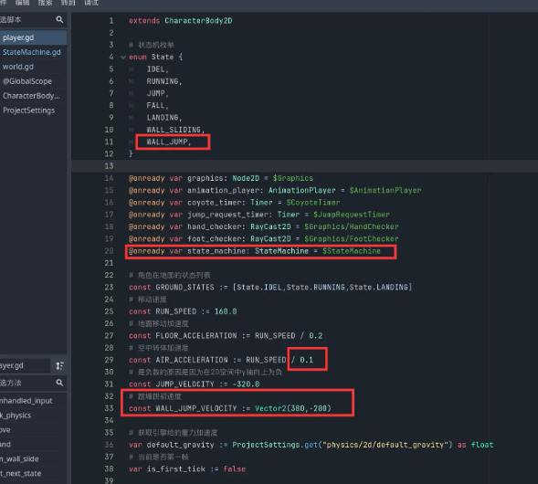
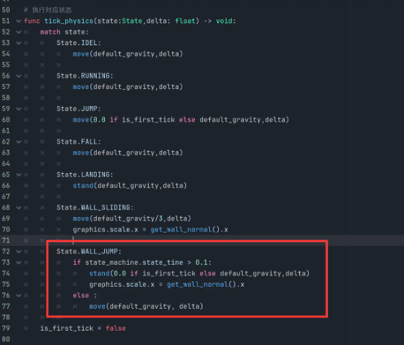
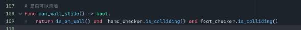
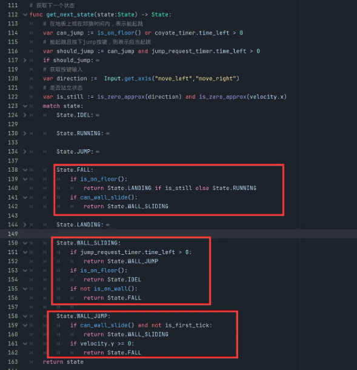
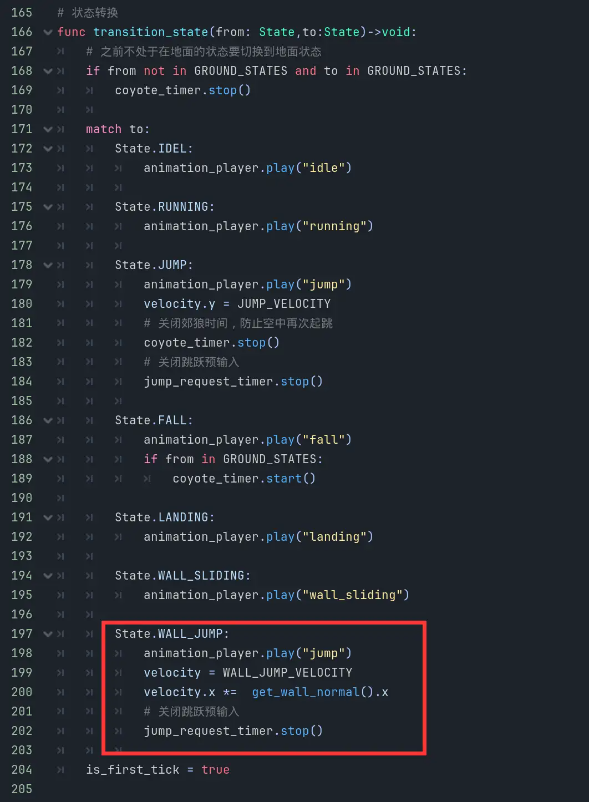
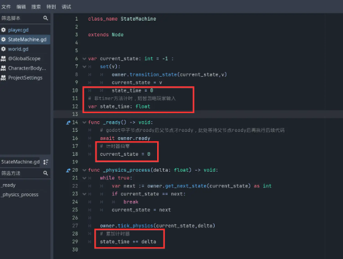

# 如何实现蹬墙跳｜Godot 4 教程《勇者传说》#7

> 原作者：瓦格良  
> 原文：[Bilibili 专栏 cv29786351](https://www.bilibili.com/read/cv29786351)  
> 所属文集：[勇者传说｜Godot 笔记](https://www.bilibili.com/read/readlist/rl782393)  
> 本地编号：8/9

---

## Godot 4.7 校订

原教程使用的 API 在 Godot 4.7 中仍有效，但蹬墙跳逻辑应修正两个细节：

- 枚举成员使用 `IDLE`，不要继续沿用 `IDEL`。
- 起跳瞬间先保存 `get_wall_normal()`，再离开墙面；离墙后读取墙法线可能得到零向量或上一帧数据。
- 输入锁定应发生在蹬墙跳后的最初约 `0.08`～`0.12` 秒。这段时间保持初始水平速度，只应用重力；锁定结束后再恢复空中转向。原代码在前 `0.1` 秒调用普通移动，方向正好相反。
- 使用 `is_on_wall_only()` 和上下两条射线共同判断可滑墙，避免墙角或单个像素接触误触发。

```gdscript
const WALL_JUMP_SPEED := 380.0
const WALL_JUMP_VELOCITY_Y := -280.0
const WALL_JUMP_INPUT_LOCK := 0.1

func begin_wall_jump() -> void:
	var wall_normal := get_wall_normal()
	velocity = Vector2(wall_normal.x * WALL_JUMP_SPEED, WALL_JUMP_VELOCITY_Y)
	jump_request_timer.stop()

func tick_wall_jump(delta: float) -> void:
	if state_machine.state_time < WALL_JUMP_INPUT_LOCK:
		velocity.y += default_gravity * delta
		move_and_slide()
	else:
		move(default_gravity, delta)
```

官方参考：[CharacterBody2D.get_wall_normal](https://docs.godotengine.org/en/4.7/classes/class_characterbody2d.html#class-characterbody2d-method-get-wall-normal)、[CharacterBody2D.move_and_slide](https://docs.godotengine.org/en/4.7/classes/class_characterbody2d.html#class-characterbody2d-method-move-and-slide)。

## 原教程正文（历史界面与代码）

人物素材： https://brullov.itch.io/generic-char-asset

环境素材： https://anokolisa.itch.io/sidescroller-pixelart-sprites-asset-pack-forest-16x16

## 场景：

- 蹬墙跳实现

  - 添加WALL_JUMP状态和初速度



- WALL_JUMP状态实现



- 优化WALL_SLIDING判断



- 添加WALL_JUMP状态获取以及优化FALL和WALL_SLIDING向其他状态切换的逻辑



- WALL_JUMP动画实现



- 避免蹬墙跳后的瞬间，角色会因为尚未来得及转换方向键而在空中转体



## 代码：

- player.gd

```gdscript
extends CharacterBody2D

# 状态机枚举
enum State {
	IDEL,
	RUNNING,
	JUMP,
	FALL,
	LANDING,
	WALL_SLIDING,
	WALL_JUMP,
}

@onready var graphics: Node2D = $Graphics
@onready var animation_player: AnimationPlayer = $AnimationPlayer
@onready var coyote_timer: Timer = $CoyoteTimer
@onready var jump_request_timer: Timer = $JumpRequestTimer
@onready var hand_checker: RayCast2D = $Graphics/HandChecker
@onready var foot_checker: RayCast2D = $Graphics/FootChecker
@onready var state_machine: StateMachine = $StateMachine

# 角色在地面的状态列表
const GROUND_STATES := [State.IDEL,State.RUNNING,State.LANDING]
# 移动速度
const RUN_SPEED := 160.0
# 地面移动加速度
const FLOOR_ACCELERATION := RUN_SPEED / 0.2
# 空中转体加速度
const AIR_ACCELERATION := RUN_SPEED / 0.1
# 是负数的原因是因为在2D空间中y轴向上为负
const JUMP_VELOCITY := -320.0
# 蹬墙跳初速度
const WALL_JUMP_VELOCITY := Vector2(380,-280)

# 获取引擎给的重力加速度
var default_gravity := ProjectSettings.get("physics/2d/default_gravity") as float
# 当前是否第一帧
var is_first_tick := false

# 使用事件回调函数_unhandled_input()判断是否按下jump按键
func _unhandled_input(event: InputEvent) -> void:
	if event.is_action_pressed("jump"):
		jump_request_timer.start()
	# 短按轻跳，长按大跳
	if event.is_action_released("jump") :
		jump_request_timer.stop()
		if  velocity.y < JUMP_VELOCITY / 2:
			velocity.y = JUMP_VELOCITY / 2

# 执行对应状态
func tick_physics(state:State,delta: float) -> void:
	match state:
		State.IDEL:
			move(default_gravity,delta)

		State.RUNNING:
			move(default_gravity,delta)

		State.JUMP:
			move(0.0 if is_first_tick else default_gravity,delta)

		State.FALL:
			move(default_gravity,delta)

		State.LANDING:
			stand(default_gravity,delta)

		State.WALL_SLIDING:
			move(default_gravity/3,delta)
			graphics.scale.x = get_wall_normal().x

		State.WALL_JUMP:
			if state_machine.state_time > 0.1:
				stand(0.0 if is_first_tick else default_gravity,delta)
				graphics.scale.x = get_wall_normal().x
			else :
				move(default_gravity, delta)

	is_first_tick = false

# 移动
func move(gravity:float, delta: float) -> void:
	# 获取按键输入
	var direction :=  Input.get_axis("move_left","move_right")
	# 如果在地面则获取地面加速度，如果不在地面，则获取空中转体加速度
	var acceleration := FLOOR_ACCELERATION if is_on_floor() else AIR_ACCELERATION
	# 修改速度向量
	velocity.x = move_toward(velocity.x, direction*RUN_SPEED, acceleration * delta)
	velocity.y += gravity * delta

	# 如果在移动，并且是向左移动，那么将角色水平翻转
	if not is_zero_approx(direction):
		graphics.scale.x = -1 if direction < 0 else +1

	move_and_slide()

# 站立
func stand(gravity : float, delta: float) -> void:
	# 如果在地面则获取地面加速度，如果不在地面，则获取空中转体加速度
	var acceleration := FLOOR_ACCELERATION if is_on_floor() else AIR_ACCELERATION
	# 修改速度向量
	velocity.x = move_toward(velocity.x, 0.0, acceleration * delta)
	velocity.y += gravity * delta

	move_and_slide()

func can_wall_slide() -> bool:
	return is_on_wall() and  hand_checker.is_colliding() and foot_checker.is_colliding()

# 获取下一个状态
func get_next_state(state:State) -> State:
	# 在地板上或在郊狼时间内，表示能起跳
	var can_jump := is_on_floor() or coyote_timer.time_left >0
	# 能起跳且按下jump按键，则表示应当起跳
	var should_jump := can_jump and jump_request_timer.time_left > 0
	if should_jump:
		return State.JUMP
	# 获取按键输入
	var direction :=  Input.get_axis("move_left","move_right")
	# 是否站立状态
	var is_still := is_zero_approx(direction) and is_zero_approx(velocity.x)
	match state:
		State.IDEL:
			if not is_on_floor():
				return State.FALL
			if not is_still:
				return State.RUNNING

		State.RUNNING:
			if is_still:
				return State.IDEL

		State.JUMP:
			if velocity.y >= 0:
				return State.FALL

		State.FALL:
			if is_on_floor():
				return State.LANDING if is_still else State.RUNNING
			if can_wall_slide():
				return State.WALL_SLIDING

		State.LANDING:
			if not is_still:
				return State.RUNNING
			if not animation_player.is_playing():
				return State.IDEL

		State.WALL_SLIDING:
			if jump_request_timer.time_left > 0:
				return State.WALL_JUMP
			if is_on_floor():
				return State.IDEL
			if not is_on_wall():
				return State.FALL

		State.WALL_JUMP:
			if can_wall_slide() and not is_first_tick:
				return State.WALL_SLIDING
			if velocity.y >= 0:
				return State.FALL
	return state

# 状态转换
func transition_state(from: State,to:State)->void:
	# 之前不处于在地面的状态要切换到地面状态
	if from not in GROUND_STATES and to in GROUND_STATES:
		coyote_timer.stop()

	match to:
		State.IDEL:
			animation_player.play("idle")

		State.RUNNING:
			animation_player.play("running")

		State.JUMP:
			animation_player.play("jump")
			velocity.y = JUMP_VELOCITY
			# 关闭郊狼时间，防止空中再次起跳
			coyote_timer.stop()
			# 关闭跳跃预输入
			jump_request_timer.stop()

		State.FALL:
			animation_player.play("fall")
			if from in GROUND_STATES:
				coyote_timer.start()

		State.LANDING:
			animation_player.play("landing")

		State.WALL_SLIDING:
			animation_player.play("wall_sliding")

		State.WALL_JUMP:
			animation_player.play("jump")
			velocity = WALL_JUMP_VELOCITY
			velocity.x *=  get_wall_normal().x
			# 关闭跳跃预输入
			jump_request_timer.stop()

	is_first_tick = true

```

- StateMachine.gd

```gdscript
class_name StateMachine

extends Node

var current_state: int = -1 :
	set(v):
		owner.transition_state(current_state,v)
		current_state = v
		state_time = 0

var state_time: float

func _ready() -> void:
	# godot中子节点ready后父节点才ready，此处等待父节点ready后再执行后续代码
	await owner.ready
	current_state = 0

func _physics_process(delta: float) -> void:
	while true:
		var next := owner.get_next_state(current_state) as int
		if current_state == next:
			break
		current_state = next

	owner.tick_physics(current_state,delta)
	state_time += delta

```
