# 野猪的基本逻辑｜Godot 4 教程《勇者传说》#8

> 原作者：瓦格良  
> 原文：[Bilibili 专栏 cv33837976](https://www.bilibili.com/read/cv33837976)  
> 所属文集：[勇者传说｜Godot 笔记](https://www.bilibili.com/read/readlist/rl782393)  
> 本地编号：9/9

---

## Godot 4.7 校订

- `CharacterBody2D` 场景继承、`RayCast2D` 感知和碰撞层/掩码方案仍然有效。本项目的环境层命名为 `World`，不是原教程中的 `Environment`。
- 身体碰撞体应贴合野猪躯干和腿部主要受击区域，不要仅因素材近似圆形就固定使用圆形。攻击判定应另建 `Area2D`，与身体碰撞分离。
- 朝向 setter 不应 `await ready`。setter 可能在资源反序列化阶段执行；先保存值，在 `_ready()` 中统一应用朝向更稳定。
- 不要用 `direction *= -1` 修改枚举并压制类型警告，改用明确的 `turn_around()`。
- Godot 4.7 的 2D Scene Paint Mode（默认 `B`）可快速摆放敌人场景，适合关卡初步布置；摆放后仍要逐个检查出生点、巡逻边界和碰撞体。

```gdscript
enum Direction {
	LEFT = -1,
	RIGHT = 1,
}

@export var direction: Direction = Direction.LEFT:
	set(value):
		direction = value
		if is_node_ready():
			_apply_direction()

func _ready() -> void:
	_apply_direction()

func _apply_direction() -> void:
	graphics.scale.x = -float(direction)

func turn_around() -> void:
	direction = Direction.RIGHT if direction == Direction.LEFT else Direction.LEFT
```

建议的碰撞职责：

| 节点 | Collision Layer | Collision Mask | 用途 |
| --- | --- | --- | --- |
| 野猪 `CharacterBody2D` | `Enemy` | `World` | 地形移动与阻挡 |
| `PlayerChecker` | 无 | `Player` | 发现玩家 |
| `WallChecker` / `FloorChecker` | 无 | `World` | 墙面和悬崖检测 |
| 敌人 `AttackBox` | `EnemyAttack` | `Player` | 独立攻击命中盒 |

本项目现有敌人基类和状态逻辑位于 [enemy.gd](../../../scripts/enemy/enemy.gd) 与 [enemy_combatant.gd](../../../scripts/enemy/enemy_combatant.gd)。官方参考：[RayCast2D](https://docs.godotengine.org/en/4.7/classes/class_raycast2d.html)、[碰撞层与掩码](https://docs.godotengine.org/en/4.7/tutorials/physics/physics_introduction.html#collision-layers-and-masks)、[Godot 4.7 发布说明](https://godotengine.org/releases/4.7/)。

## 原教程正文（历史界面与代码）

人物素材： https://brullov.itch.io/generic-char-asset

环境素材： https://anokolisa.itch.io/sidescroller-pixelart-sprites-asset-pack-forest-16x16

## 知识点

- Collision Layer 碰撞层

  - 节点自身所处的碰撞层

  - 一个节点可以同时位于多个不同的碰撞层上，也可以不处于任何碰撞层

- Collision Mask 碰撞遮罩/碰撞掩码

  - 当前节点能够和哪些碰撞层的对象相碰撞

- 实际应用最好命名碰撞/遮罩层，而不是使用默认的数字标识

## 场景

- 创建敌人

  - 新建场景，根节点CharacterBody2D，重命名为Enemy

  - 根节点下添加一个Node2D节点并改名为Graphics

    - 添加一个Sprite2D节点

  - 根节点下添加一个CollisionShape2D节点来定义碰撞形状

  - 根节点下添加一个AnimationPlayer节点用来定义动画

  - 根节点下添加一个StateMachine节点用来定义具体的逻辑

  - 保存场景命名为enemy

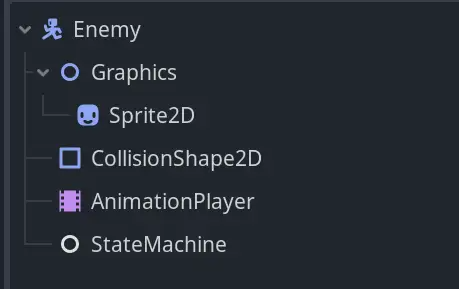

- 在根节点添加一个脚本，用来定义敌人的类

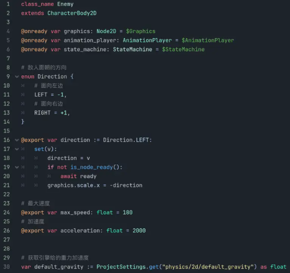

- 创建野猪

  - 新建场景，点击链条按钮，以enemy.tscn场景为父场景

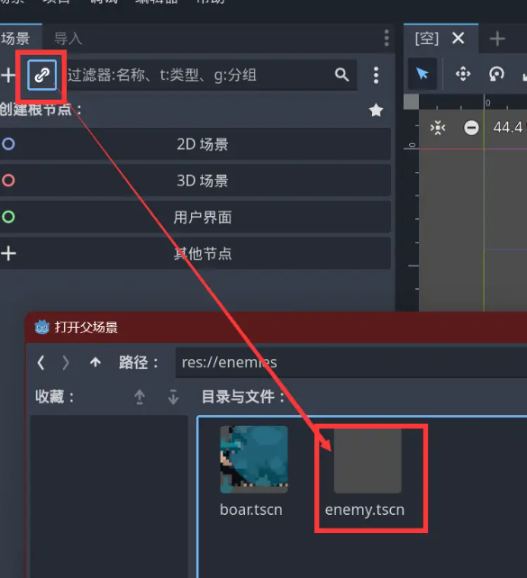

- 黄色节点是继承过来的节点

- 将新建场景的根节点改名为Boar并保存场景

- 添加野猪的4个动画(步骤参考前期笔记，此处省略)

  - hit不开启动画循环，idle、run、walk开启动画循环

- 为野猪的CollisionShape2D节点设置圆形碰撞区域

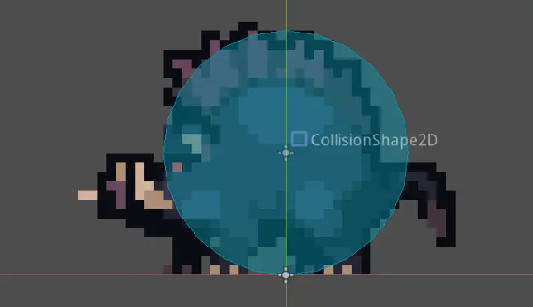

- 为Graphics节点添加RayCast2D节点，改名为WallChecker，调整到眼睛位置

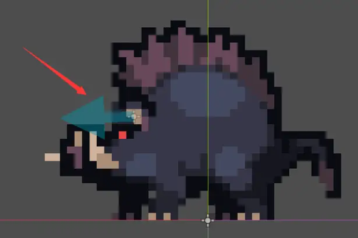

- 添加RayCast2D节点，改名为FloorChecker，不要放到x轴上，调整到下巴附近位置

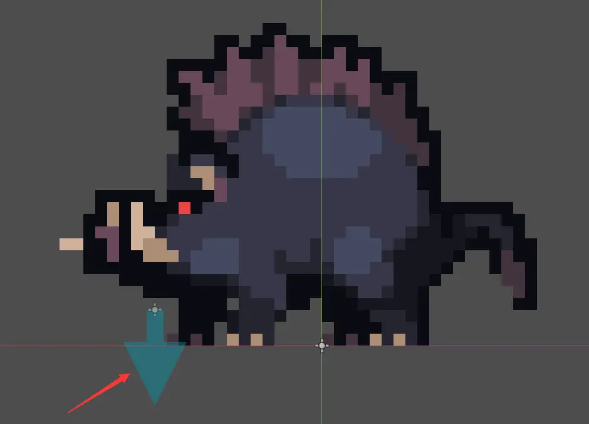

- 添加RayCast2D节点，改名为PlayerChecker，调整到视野前方，并适当拉长

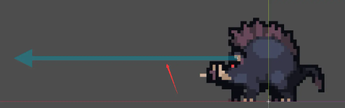

- 野猪节点展示

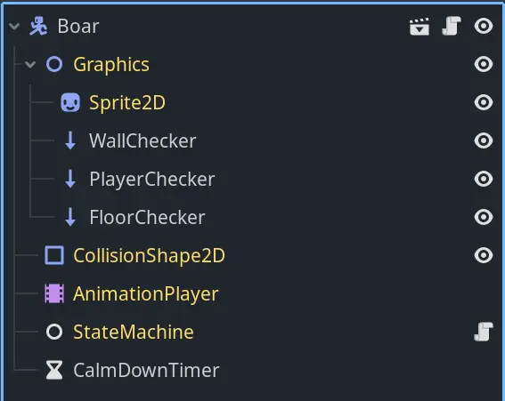

- 调整碰撞层

  - 将Player的碰撞层设置于Player层

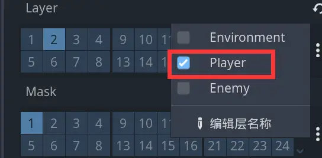

- 将Player的遮罩层设置为只能和Environment层相碰撞

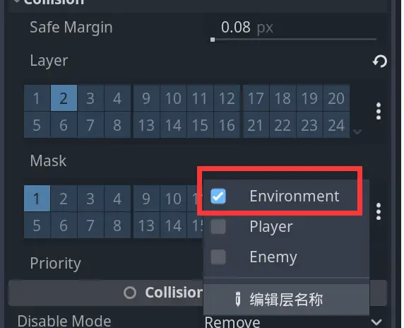

- 将Boar的碰撞层设置为Enemy层

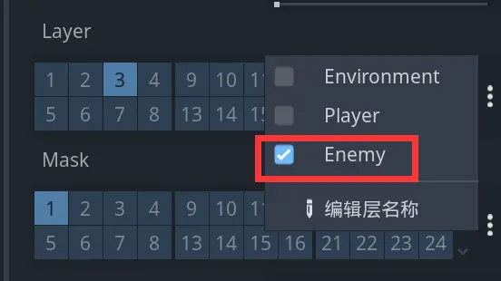

- 将Boar的遮罩层设置为只能和Environment层相碰撞

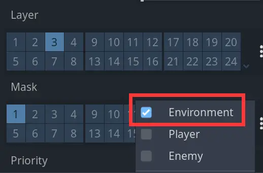

- 将PlayerChecker的遮罩层设置为只能和Player层相碰撞

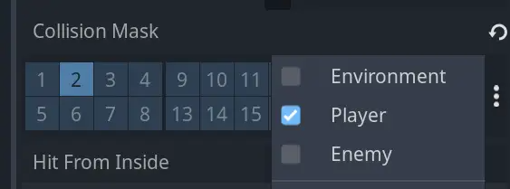

- 将FloorChecker和WallChecker的遮罩层设置为只能和Environment层相碰撞

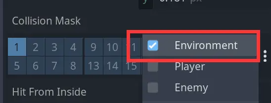

- 逻辑实现

  - 在Boar场景的根节点右键，选择扩展脚本，用来处理野猪的逻辑状态

  - 为Boar场景添加Timer节点，改名为CalmDownTimer，用来给记录野猪从遇到玩家奔跑到看不到玩家之后的冷静时间，等待时间设置为2.5秒，勾选One Shot，并拖入扩展脚本中

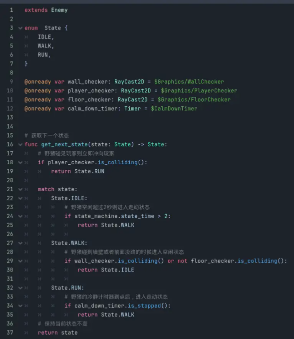

- 为enemy.gd脚本添加移动函数

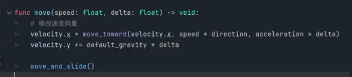

- 处理boar.gd中野猪行为的每一帧行为

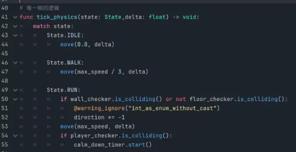

- 添加敌人

  - 在world.tscn场景中点击链条按钮，选择boar.tscn场景，添加一只野猪进行测试

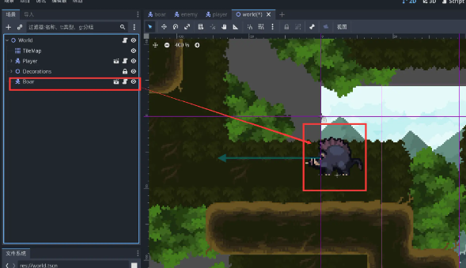

## 代码

- enemy.gd

```gdscript
class_name Enemy
extends CharacterBody2D

@onready var graphics: Node2D = $Graphics
@onready var animation_player: AnimationPlayer = $AnimationPlayer
@onready var state_machine: StateMachine = $StateMachine

# 敌人面朝的方向
enum Direction {
	# 面向左边
	LEFT = -1,
	# 面向右边
	RIGHT = +1,
}

@export var direction := Direction.LEFT:
	set(v):
		direction = v
        # 等待节点ready
		if not is_node_ready():
			await ready
		graphics.scale.x = -direction

# 最大速度
@export var max_speed: float = 180
# 加速度
@export var acceleration: float = 2000

# 获取引擎给的重力加速度
var default_gravity := ProjectSettings.get("physics/2d/default_gravity") as float

func move(speed: float, delta: float) -> void:
	# 修改速度向量
	velocity.x = move_toward(velocity.x, speed * direction, acceleration * delta)
	velocity.y += default_gravity * delta

	move_and_slide()

```

- boar.gd

```gdscript
extends Enemy

enum  State {
	IDLE,
	WALK,
	RUN,
}

@onready var wall_checker: RayCast2D = $Graphics/WallChecker
@onready var player_checker: RayCast2D = $Graphics/PlayerChecker
@onready var floor_checker: RayCast2D = $Graphics/FloorChecker
@onready var calm_down_timer: Timer = $CalmDownTimer

# 每一帧的逻辑
func tick_physics(state: State,delta: float) -> void:
	match state:
		State.IDLE:
			move(0.0, delta)

		State.WALK:
			move(max_speed / 3, delta)

		State.RUN:
			if wall_checker.is_colliding() or not floor_checker.is_colliding():
				@warning_ignore("int_as_enum_without_cast")
				direction *= -1
			move(max_speed, delta)
			if player_checker.is_colliding():
				calm_down_timer.start()

# 获取下一个状态
func get_next_state(state: State) -> State:
	# 野猪碰见玩家则立即冲向玩家
	if player_checker.is_colliding():
		return State.RUN

	match state:
		State.IDLE:
			# 野猪空闲超过2秒则进入走动状态
			if state_machine.state_time > 2:
				return State.WALK

		State.WALK:
			# 野猪碰到墙壁或者前面没路的时候进入空闲状态
			if wall_checker.is_colliding() or not floor_checker.is_colliding():
				return State.IDLE

		State.RUN:
			# 野猪的冷静计时器到点后，进入走动状态
			if calm_down_timer.is_stopped():
				return State.WALK
	# 保持当前状态不变
	return state

# 状态转换
@warning_ignore("unused_parameter")
func transition_state(from: State,to: State) -> void:
	print("[%s] %s => %s" %[
		Engine.get_physics_frames(),
		State.keys()[from] if from != -1 else "<START>",
		State.keys()[to],
	])
	match to:
		State.IDLE:
			animation_player.play("idle")
			# 如果前方是墙，则野猪转身
			if wall_checker.is_colliding():
				@warning_ignore("int_as_enum_without_cast")
				direction *= -1

		State.WALK:
			animation_player.play("walk")
			# 如果前方是悬崖，则野猪转身
			if not floor_checker.is_colliding():
				@warning_ignore("int_as_enum_without_cast")
				direction *= -1
                # 转身后强制更新射线的缓存
				floor_checker.force_raycast_update()

		State.RUN:
			animation_player.play("run")

```
